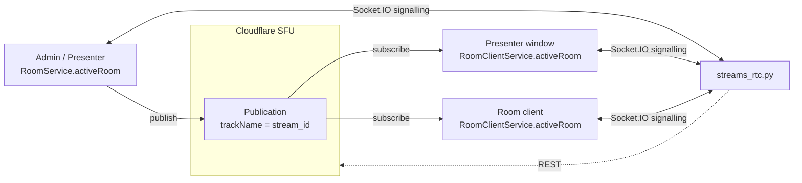
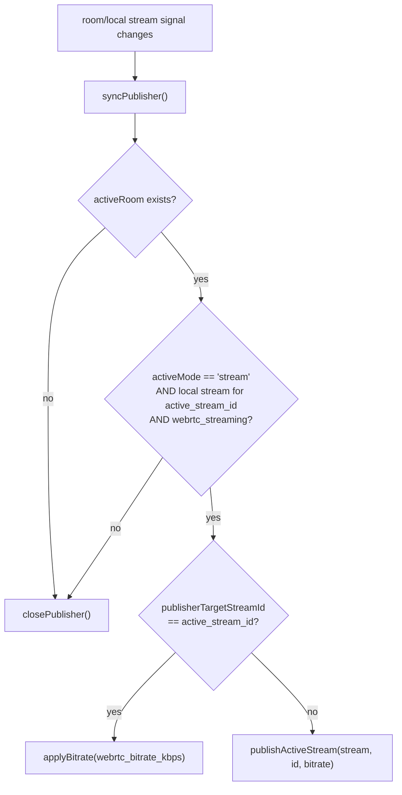
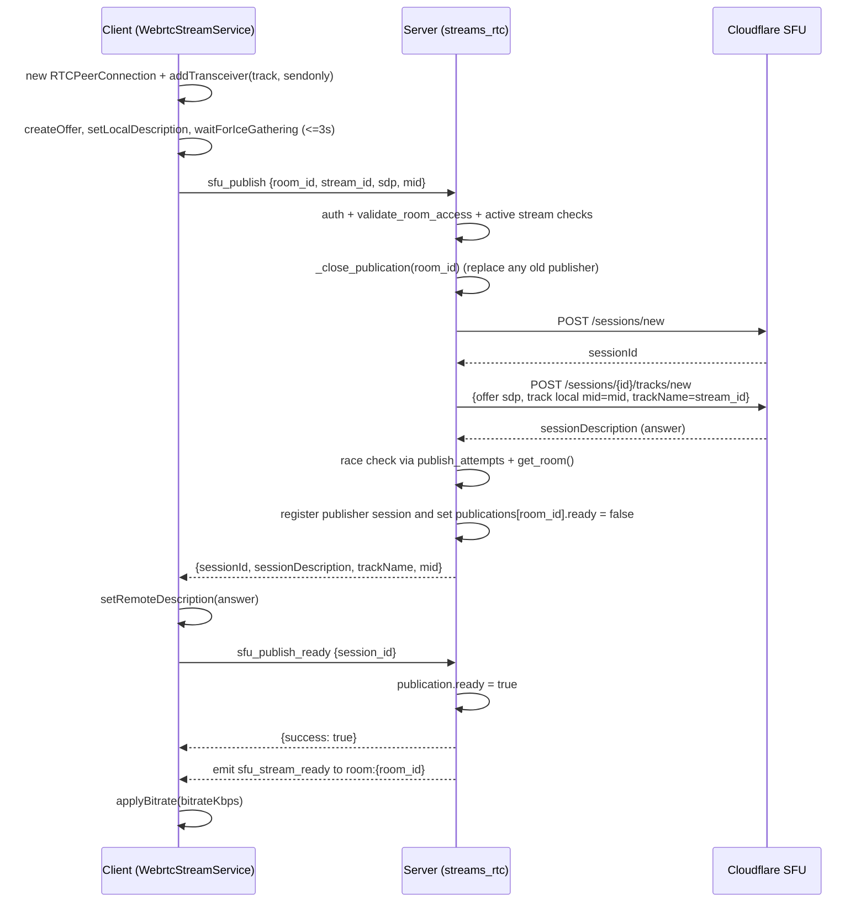
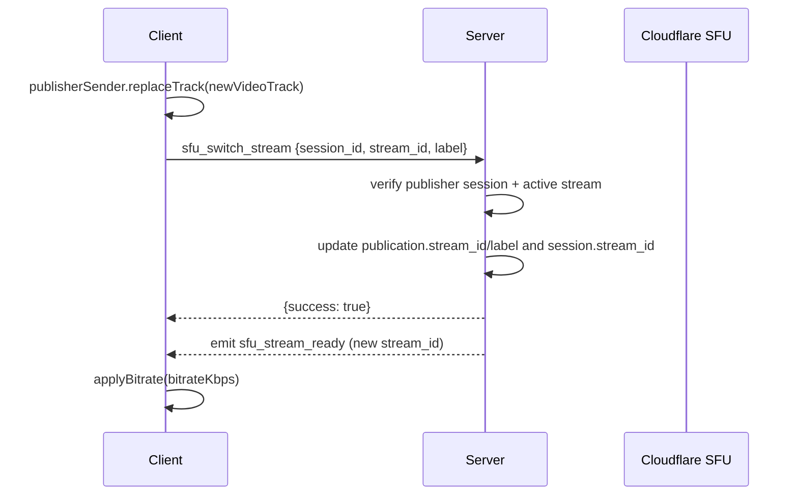
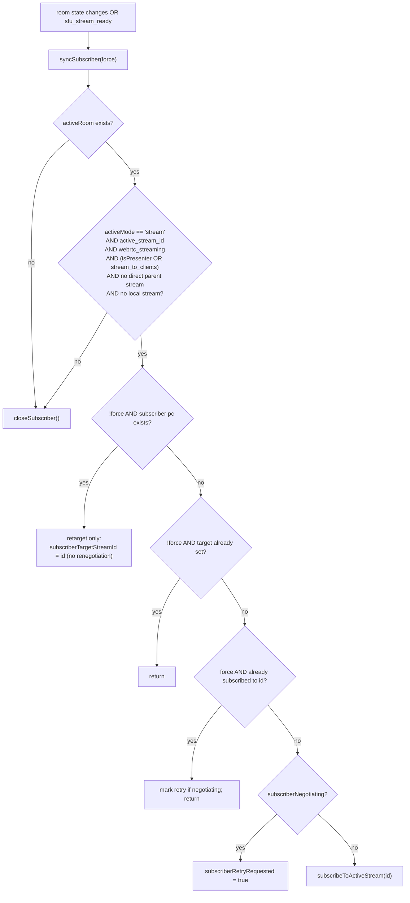
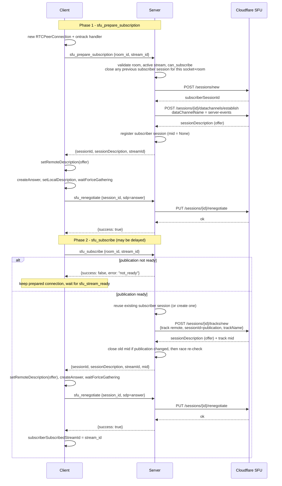

# WebRTC Streaming

Spark can broadcast one active screen share per room to the presentation view
and to clients. Two transports are supported:

- **Frame streaming** (legacy/fallback): the admin sends periodic PNG frames
  over Socket.IO. See `server/src/spark/socket/streams.py` and
  `frame-stream-service.ts`.
- **WebRTC streaming**: the admin publishes the screen-share video track to
  [Cloudflare Realtime SFU](https://developers.cloudflare.com/realtime/sfu/),
  and viewers receive the track directly over WebRTC.

This document describes the WebRTC path. The two relevant pieces of code are:

| Side     | File                                             | Responsibility                                  |
| -------- | ------------------------------------------------ | ----------------------------------------------- |
| Client   | `frontend/src/app/service/webrtc-stream-service.ts` | `RTCPeerConnection`s, SDP, publisher/subscriber state |
| Server   | `server/src/spark/socket/streams_rtc.py`         | Socket.IO signalling, session bookkeeping, Cloudflare SFU calls |
| Server   | `server/src/spark/sfu.py`                        | Thin wrapper around the Cloudflare SFU REST API |

## Overview

Spark uses a **publish/subscribe** model on top of the SFU:

- Exactly **one publisher** per room is allowed at a time. The publisher is the
  admin/presenter side that has a local screen-share `MediaStream`.
- Any number of **subscribers** connect to the active publication. A subscriber
  is either the presenter window (receiving a stream produced by a
  `DirectStreamService` opener) or a room client.
- The room document drives everything through its stream config:
  `active_mode == "stream"`, `stream.active_stream_id`, `stream.webrtc_streaming`,
  `stream.stream_to_clients`, `stream.webrtc_bitrate_kbps`.

The server keeps short-lived in-memory state, keyed by Cloudflare `sessionId`
and by Socket.IO `sid`:



### Server state

All state in `add_socket_routes` is per-process and in memory:

| Variable                 | Key            | Value                                                             |
| ------------------------ | -------------- | ----------------------------------------------------------------- |
| `sfu_sessions`           | `session_id`   | `{sid, role, room_id, stream_id, mid}`                            |
| `sfu_sessions_by_socket` | `sid`          | set of `session_id` owned by that socket                          |
| `publications`           | `room_id`      | `{session_id, stream_id, track_name, mid, label, ready}`          |
| `publish_attempts`       | `room_id`      | sentinel object used to detect an overtaken `sfu_publish`         |
| `subscriptions_by_room`  | `room_id`      | set of subscriber `session_id`s                                   |

A `role` is either `publisher` or `subscriber`. A socket can own at most one
publisher session but multiple subscriber sessions (one per room).

### Socket.IO events

| Event                      | Direction        | Purpose                                                     |
| -------------------------- | ---------------- | ----------------------------------------------------------- |
| `sfu_publish`              | client → server  | Create publisher session and add the local offer            |
| `sfu_publish_ready`        | client → server  | Mark publication ready; triggers `sfu_stream_ready`         |
| `sfu_switch_stream`        | client → server  | Swap track on an existing publisher session                 |
| `sfu_prepare_subscription` | client → server  | Create subscriber session and connect its DataChannel       |
| `sfu_subscribe`            | client → server  | Add the remote publication track to the subscriber session  |
| `sfu_renegotiate`          | client → server  | Send the subscriber answer SDP                              |
| `sfu_close`                | client → server  | Close one session, or all sessions of the socket            |
| `sfu_stream_ready`         | server → room    | A publication is ready; subscribers should subscribe        |
| `sfu_stream_unavailable`   | server → room    | A publication ended; subscribers should drop remote media   |
| `disconnect`               | Socket.IO system | Close all sessions owned by the disconnecting socket        |

Every request handler returns an `ApiResponse`-shaped result:
`{success: true, data: ...}` or `{success: false, error: ...}`. The client
`emitSfu` helper resolves the callback and applies a **15 s timeout**
(`sfuRequestTimeoutMs`), resolving an error response if the server never
answers.

## Address configuration

Both the publisher and subscriber `RTCPeerConnection`s use the same
configuration:

```ts
{
  iceServers: [{ urls: 'stun:stun.cloudflare.com:3478' }],
  bundlePolicy: 'max-bundle',
}
```

ICE gathering is bounded by `waitForIceGathering`, which resolves when
`iceGatheringState === 'complete'` or after **3 s**. The local SDP is then sent
to the server, which relays it to the SFU.

## Publisher flow

The publisher is driven by an Angular `effect` that calls `syncPublisher()`
whenever room or local stream state changes.



`publishActiveStream` has two paths.

### First publication (fresh PeerConnection)



Notes:

- Before creating a new session the server closes any existing publication for
  the room, emitting `sfu_stream_unavailable` to the room (see
  [Publisher replacement](#publisher-replacement)).
- The `publish_attempts` sentinel protects against a slow `sfu_publish` that
  finishes after the active stream already changed: the late session is closed
  and rejected with `"The stream is no longer active."`.
- `sfu_publish_ready` is what makes the publication visible to subscribers.
  The publisher is only considered live after this call.

### Switching streams on a live connection

When the active stream changes but the publisher already has a healthy
`RTCPeerConnection` (`canReplacePublisherTrack()`), Spark avoids a full
renegotiation. It only swaps the source track on the existing sender:



The SFU session and all subscriber connections stay up; subscribers receive a
new `sfu_stream_ready` and re-subscribe on their existing sessions.

A generation counter (`publisherGeneration`) guards every `await`. If state
changes mid-flight (e.g. the user disables WebRTC), the pending result is
discarded, and any session already created on the server is explicitly closed
with `sfu_close`.

### Publisher replacement

When a publisher session ends (`sfu_close`, disable, disconnect, or a new
publisher in the same room), `_close_session` runs:

- If it is the current publication, the publication is removed and
  `sfu_stream_unavailable` is broadcast to the room.
- `_detach_room_subscriptions` closes the publication's track on every
  subscriber session **but keeps the sessions and their WebRTC transports
  alive** (sets the session `mid` back to `None`). This lets the next publisher
  in the same room reuse the connected subscribers; only the remote media needs
  to be added again.

## Subscriber flow

The subscriber is driven by a second Angular `effect` plus the
`sfu_stream_ready` event.



The key idea is a **two-phase subscription**:

1. `sfu_prepare_subscription` creates the SFU session and connects the WebRTC
   transport **before the media track exists**, by establishing the reserved
   `server-events` DataChannel. This makes the connection ready early.
2. `sfu_subscribe` later adds the remote publication track, which only needs a
   media renegotiation on the already-connected session.

### Prepare + subscribe



The `ontrack` handler installs the received track as
`activeWebrtcStream = new MediaStream([event.track])`, which the room view binds
to a `<video>` element. Any previous stream's tracks are stopped first. The
handler is generation-guarded: a late track from a superseded connection is
stopped immediately.

### Stream ready / unavailable events

- **`sfu_stream_ready`** is emitted by the server to `room:{room_id}` after
  `sfu_publish_ready` or `sfu_switch_stream`. The client ignores it unless the
  room and `active_stream_id` match, and ignores it if the stream is one of its
  own local streams. Otherwise it calls `syncSubscriber(true)` to force
  (re)subscription.
- **`sfu_stream_unavailable`** is emitted when the current publication ends.
  `handleSubscriberStreamUnavailable()` clears `subscriberSubscribedStreamId`,
  stops and clears `activeWebrtcStream`, **but keeps the subscriber
  PeerConnection and SFU session**. A later `sfu_stream_ready` from a new
  publisher re-subscribes on the same connection.

### Retargeting without renegotiation

`syncSubscriber` is also called on every room update. When a live subscriber
PeerConnection already exists, Spark only updates `subscriberTargetStreamId`
and returns; it does not start a renegotiation before the publisher has
announced the new stream. The actual re-subscribe is deferred to the
`sfu_stream_ready` event.

If a sync arrives while a subscription is in flight
(`subscriberNegotiating`), the request is coalesced by setting
`subscriberRetryRequested`. When the in-flight operation finishes, it calls
`syncSubscriber(true)` once.

## Bitrate control

The admin room settings expose `webrtc_bitrate_kbps`. Both flows update the
active sender's SDP parameters:

```ts
encoding.maxBitrate = kbps * 1000; // bits per second
await sender.setParameters(parameters);
```

`applyBitrate` is idempotent (`appliedBitrateKbps`), validates the value, and
falls back to resetting the cached value if `setParameters` rejects. A stream
switch calls `applyBitrate` again because the new track may have different
parameters. Bitrate is applied to the publisher's `RTCRtpSender`; subscribers
are receivers and do not set it.

## Cleanup

| Action                    | Effect                                                                                       |
| ------------------------- | -------------------------------------------------------------------------------------------- |
| `closePublisher()`        | Bump `publisherGeneration`, clear target, `releasePublisher()`                                |
| `releasePublisher()`      | Null/handle all publisher refs, close the `RTCPeerConnection`, emit `sfu_close` for its session |
| `closeSubscriber()`       | Bump `subscriberGeneration`, clear target/negotiating/retry flags, `releaseSubscriber()`     |
| `releaseSubscriber()`     | Close subscriber `RTCPeerConnection`, stop/clear `activeWebrtcStream`, emit `sfu_close`       |
| `handleSubscriberStreamUnavailable()` | Drop remote media only; keep connection and session                              |
| server `disconnect`       | `_close_socket_sessions(sid)` closes every session owned by the socket                         |
| server `sfu_close` no id  | `_close_socket_sessions(sid)` (all roles)                                                      |

On the server, `_close_session` is the single teardown point: it removes the
session from both indexes, updates `publications`/`subscriptions_by_room`, emits
`sfu_stream_unavailable` for a current publisher, and closes the Cloudflare
track (`sfu.close_tracks` with `force: true`).

## Public client API

| Member                                      | Description                                                            |
| ------------------------------------------- | ---------------------------------------------------------------------- |
| `activeWebrtcStream` (signal)               | The subscribed `MediaStream`, bound by the room view                   |
| `errorMessage` (signal)                     | Last publisher/subscriber error, surfaced in the admin UI              |

## Invariants and gotchas

- **One publication per room.** `sfu_publish` closes the previous publication
  before creating a new session. `publications[room_id]` is the source of truth.
- **`ready` matters.** `sfu_subscribe` refuses with `not_ready` until
  `sfu_publish_ready` has run, so subscribers never race the publisher.
- **Reuse over rebuild.** Both publishers (track swap) and subscribers
  (DataChannel-prepared transport, retained on `sfu_stream_unavailable`) keep
  existing connections whenever possible.
- **Generation guards.** Every async path in the client checks its generation
  after each `await`; stale work is abandoned and any server session created by
  stale work is closed explicitly.
- **Authority is server-side.** The client's `shouldPublish`/`shouldSubscribe`
  checks are an optimisation; the server independently re-validates login, room
  access, active mode, active stream, and `webrtc_streaming`/`stream_to_clients`.
- **In-memory state is not durable.** A server restart drops all sessions and
  publications; clients recover through the normal `syncPublisher` /
  `sfu_stream_ready` path.
